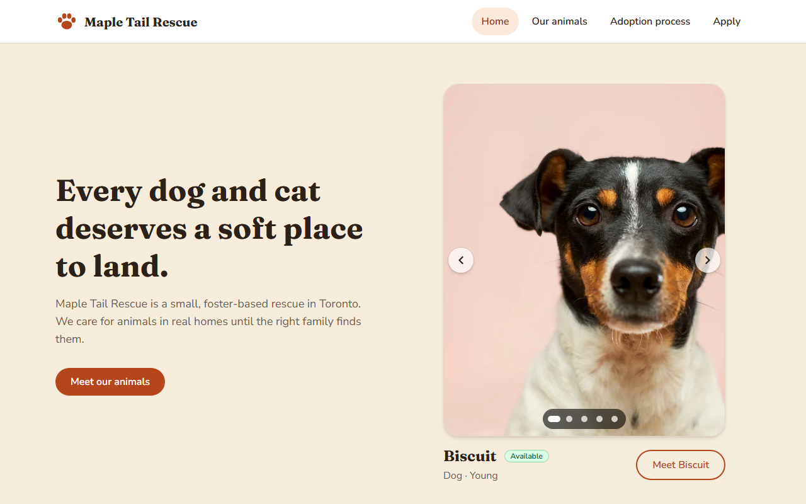
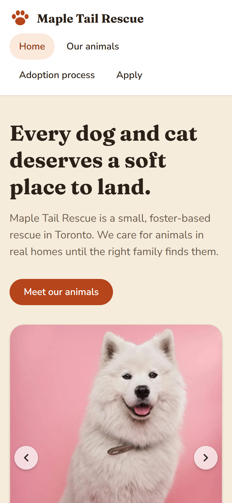
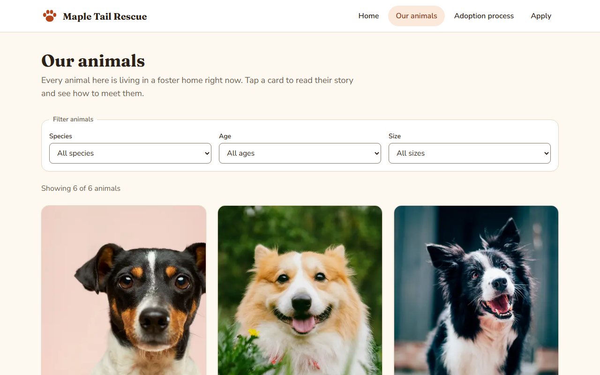
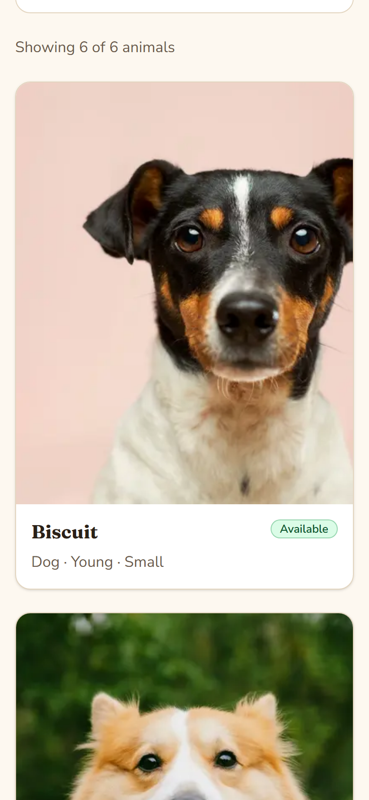
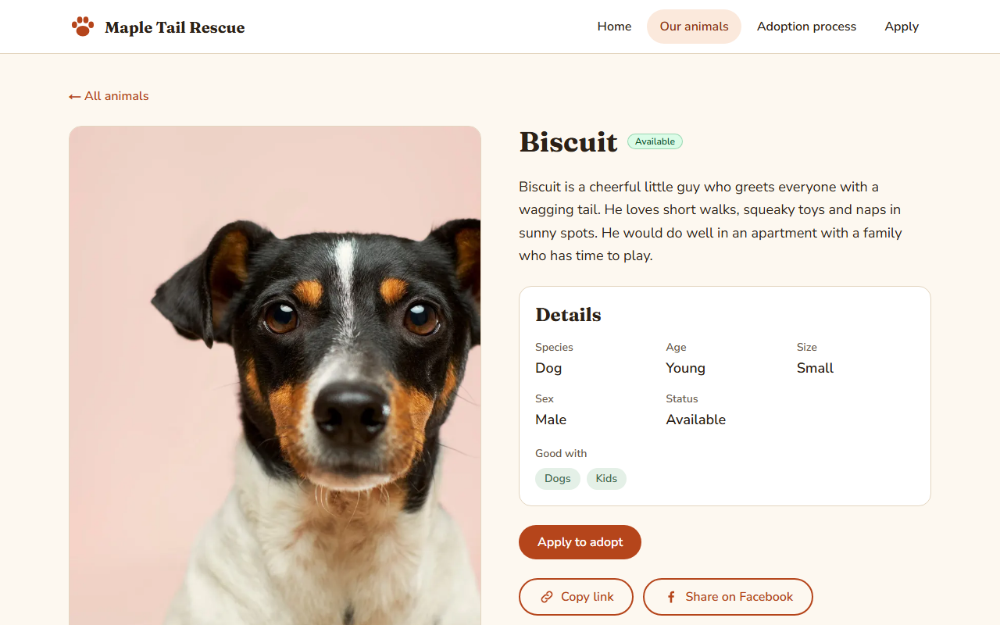
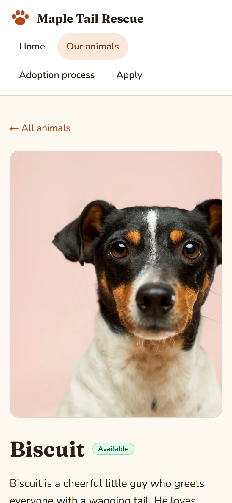
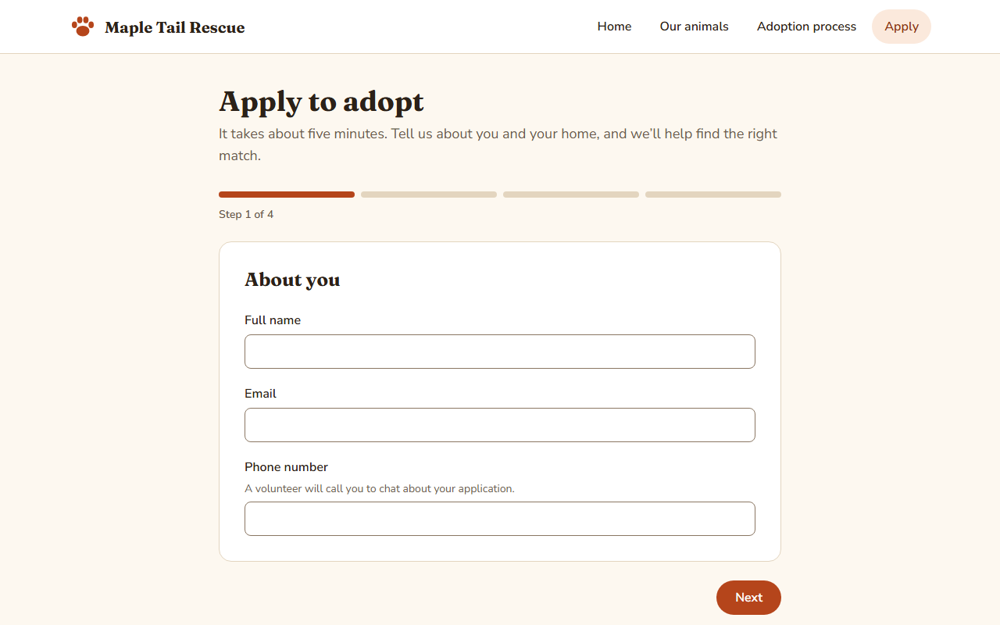
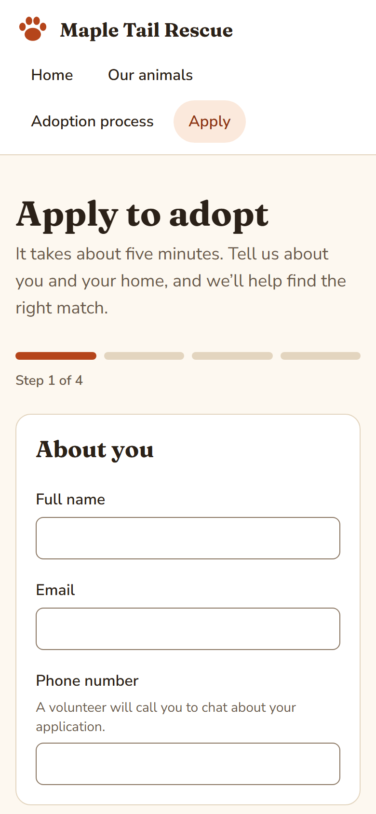

# Maple Tail Rescue

**Live demo: https://maple-tail-rescue.pages.dev**

A demo adoption website for a **fictional foster-based dog and cat rescue in Toronto**. I built it as a volunteer-project pitch for real rescues: a fast public site where adopters can browse animals and apply, with each application emailed straight to the rescue. The rescue, its animals and its social accounts are all made up.

## Screenshots

| | Desktop | Phone |
| --- | --- | --- |
| Home |  |  |
| Animals list |  |  |
| Animal detail |  |  |
| Apply form |  |  |

## What it does

- **Public site:** home page with a rotating carousel of animals waiting for homes, a filterable animals list, animal detail pages with sharing and Open Graph metadata, an adoption process page, and a four-step application form.
- **Applications:** sent by email to the rescue through [Formspree](https://formspree.io), with readable field names, the animal's name in the subject and the applicant's address as reply-to, so a volunteer can answer straight from their inbox. A honeypot field and a privacy note are included.

## Tech stack and architecture

| Layer | Choice |
| --- | --- |
| Content | Headless WordPress (LocalWP) with Advanced Custom Fields |
| Data pipeline | `npm run sync` script: WordPress REST API → `src/data/animals.json` + photos in `public/animals/` |
| Frontend | Next.js 16 (App Router, **static export**), React 19, TypeScript, Tailwind CSS 4 |
| Hosting | Cloudflare Pages (see [DEPLOY.md](DEPLOY.md)) |
| Forms | React Hook Form + Zod |
| Applications | Formspree (emails each application to the rescue), called from the browser |

Headless WordPress → sync script → Next.js static export on Cloudflare Pages; applications are emailed to the rescue through Formspree.

```
WordPress + ACF ──sync script──▶ animals.json + photos ──next build──▶ static site (out/)
                                                                           │
                                         browser ──application──▶ Formspree ──email──▶ the rescue
```

**Why no database?** A small volunteer rescue can't maintain one. An email in the inbox is something they already know how to handle; accounts, backups, security patches and an admin area are not.

The site has no server and no database at runtime. Animal data is baked in at build time, so changes in WordPress show up after running `npm run sync` and rebuilding.

## Key design decisions

- **Decoupled data mapping.** WordPress shapes (ACF fields, media IDs, HTML-encoded titles) are translated into a clean `Animal` type in one place, the sync script. The frontend never sees WordPress, so the CMS could be swapped without touching components. Likewise, `src/lib/formspree.ts` is the single place that turns a validated application into the email's fields.
- **Static export.** Fast, cheap to host anywhere, and nothing to patch. The trade-off: no server-side code.
- **No database, on purpose.** A small volunteer rescue can't maintain one: no accounts to manage, nothing to patch or back up, no admin area to keep secure. An application is an email, which the rescue already knows how to handle. The Formspree endpoint is public by design (it ends up in the site's JavaScript); it can only receive submissions, not read any.
- **One source of truth for form rules.** `src/lib/application-schema.ts` is plain Zod and drives the form's validation; it is the only place the form's rules live.
- **Accessibility built in, not audited.** Semantic HTML, keyboard-operable controls with visible focus rings, labelled form fields with error messages, a skip link, and `prefers-reduced-motion` support. The carousel can be paused, doesn't auto-advance while hovered or keyboard-focused, and only announces slides the visitor changed. Automated checks run in the end-to-end tests (axe-core on the home, animals, detail, apply and adoption-process pages, failing on serious or critical violations), and a unit test measures the carousel controls' contrast against every photo, since axe can't judge text or controls drawn over images. Automated tools find only part of the real problems: I have not done a manual audit or tested with a range of screen readers.

## Local setup

**Requirements:** Node.js 20.9+ (`.nvmrc` pins 22, which CI uses; `nvm use` picks it up), [LocalWP](https://localwp.com/), a free [Formspree](https://formspree.io/) form.

1. **Install dependencies**
   ```bash
   npm install
   ```
2. **WordPress (LocalWP).** Create a site at `http://paws-demo.local` (or set `WP_URL` to wherever yours lives). Install the **Advanced Custom Fields** plugin and:
   - register a custom post type with the slug `animal`, REST API enabled, and Featured Image support (the featured image is each animal's main photo);
   - import [`wordpress/acf-animal-fields.json`](wordpress/acf-animal-fields.json) via ACF → Tools → Import Field Groups;
   - add a few published animals.
3. **Sync the animals** (WordPress must be running):
   ```bash
   npm run sync
   ```
   This writes `src/data/animals.json` and saves resized versions of each photo (WebP, plus a JPEG for link previews) into `public/animals/`. The repo already contains a synced copy of the demo data, so you can skip steps 2–3 just to try the site.

   The sync is all-or-nothing: it builds everything in `.sync-staging/`, checks it, and only then swaps it in. If WordPress is down, an animal has an invalid field, a photo can't be downloaded or the result isn't valid, it stops with a message and the previous photos and `animals.json` are left untouched.
4. **Formspree.** Copy `.env.example` to `.env.local` and put your form's endpoint (`https://formspree.io/f/…`) in `NEXT_PUBLIC_FORMSPREE_ENDPOINT`.
5. **Run it**
   ```bash
   npm run dev
   ```
   Open http://localhost:3000. Submitting the form in development sends a real email to the address on your Formspree form.

`NEXT_PUBLIC_SITE_URL` (the deployed address, used for share previews) isn't needed for `npm run dev`, but it is for a production build; see below.

## Production builds

`NEXT_PUBLIC_FORMSPREE_ENDPOINT` and `NEXT_PUBLIC_SITE_URL` are baked into the built site. To stop a build with a missing or placeholder value from being deployed, `npm run build` (and `next build`) fails with a list of what's wrong if any of them is unset, still a placeholder from `.env.example`, or a non-https or local address. Dev, `npm run typecheck` and the tests are not affected.

For a throwaway build with dummy values, set `ALLOW_PLACEHOLDER_ENV=1` (CI and the Playwright tests do). Never deploy a build made that way.

## Scripts

| Script | What it does |
| --- | --- |
| `npm run dev` | Start the dev server |
| `npm run build` | Build the static site into `out/`. Refuses to run with missing or placeholder config (see Production builds). |
| `npm run sync` | Pull animals and photos from WordPress into `src/data` and `public/animals` |
| `npm run lint` | Run ESLint |
| `npm run typecheck` | Generate Next.js route types, then run the TypeScript compiler |
| `npm test` | Unit tests (Vitest): WordPress data mapping, label helpers, sorting, the application schema, the email sent to Formspree, the bot-trap decision, and the production-config check |
| `npm run test:e2e` | End-to-end tests (Playwright, Chromium): the public flow (home → animals → filter → detail → apply → success) the application form's conditional questions and bot trap, and axe accessibility checks. They build the site and mock the Formspree request, so they never send a real email. First run needs `npx playwright install chromium`. |

## Continuous integration

GitHub Actions (`.github/workflows/ci.yml`) runs on every push and pull request:

- **Checks job:** lint, type-check, unit tests, a step that proves a production build with no config is refused, then the build itself (with `ALLOW_PLACEHOLDER_ENV=1`, since CI has no real Formspree form or site address).
- **End-to-end job:** the Playwright tests against the built site.

It uses no secrets.

## Limitations

- **Tests cover the logic and the main flows, not everything.** There are unit tests for the pure logic, and end-to-end tests for the public application flow and the bot trap. The carousel's pause and reduced-motion behaviour is untested.
- **Spam protection is light.** A hidden bot-trap field catches simple bots (it drops a submission only if the trap is filled *and* the form was sent within 3 seconds, so autofill can't lose a real application; Formspree's own spam filtering applies on top). There is no CAPTCHA, so a determined script that knows the public endpoint can still send emails, within Formspree's plan limits. Dropped bot submissions are only logged to the visitor's browser console; there is no server-side record.
- **Applications live in an inbox.** There is no status tracking or search beyond the rescue's email; Formspree also keeps a copy of each submission in its dashboard, according to the plan. Applicants don't get an automatic confirmation; the success screen says a volunteer will email them, which is a manual step.
- Next.js can't optimize images in a static export, so `npm run sync` does it instead: each photo is cropped to 4:5 and saved as an 800px WebP (detail page and home carousel), a 400px WebP (cards) and a JPEG for link previews. There is no per-device `srcset`.
- Animal changes need a re-sync and rebuild; there is no live preview or webhook.
- No privacy policy page or data-retention process yet.

## Photo credits

The animal photos come from [Unsplash](https://unsplash.com) and are used under the [Unsplash License](https://unsplash.com/license). Photographers: Baptist Standaert, Victor G, Peri Stojnic, Alvan Nee and Alexander London. The photos are stand-ins for a fictional rescue's animals, and the animals pictured are not real rescue animals.

## Fonts

[Fraunces](https://github.com/undercasetype/Fraunces) (headings) and [Nunito Sans](https://github.com/Fonthausen/NunitoSans) (body), under the SIL Open Font License 1.1. The Latin variable-font files are committed in `src/app/fonts/` with their license texts, so builds never need to reach Google Fonts.

## License

Released under the [MIT License](LICENSE). The Unsplash photos are not covered by it; see Photo credits above.
